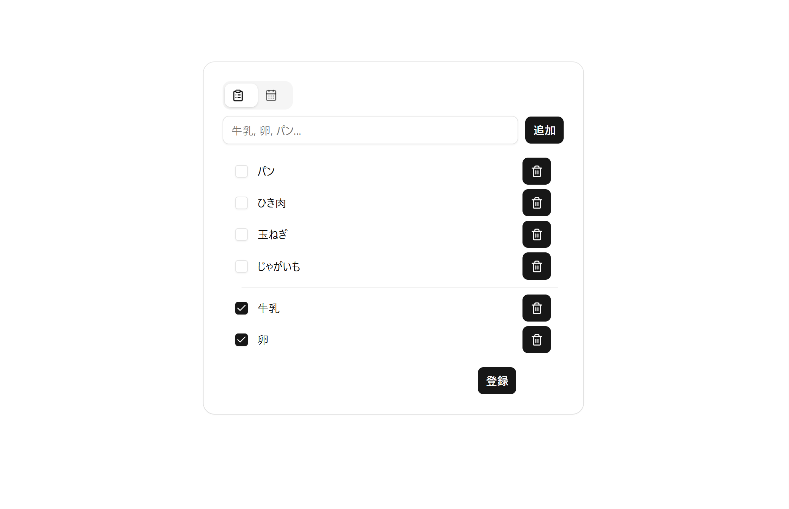
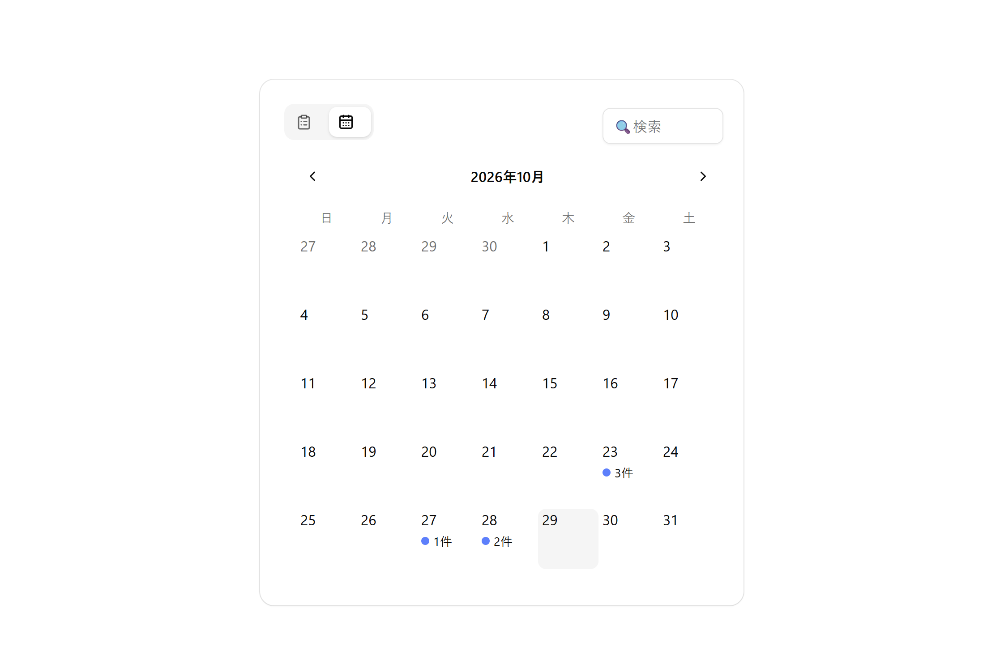
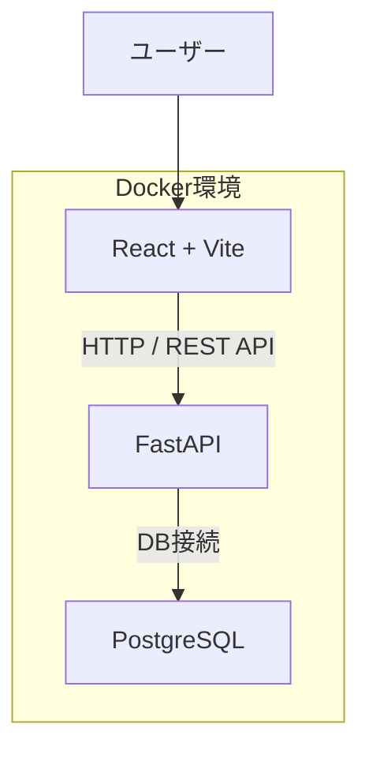

# 買い物リスト
<p align="center">
    
    
</p>

## 目的
Webアプリケーションの開発を通じて、フロントエンドからデータベースまでの基本的な仕組みを理解すること
- フロントエンドとバックエンドのデータのやり取り
- Dockerによる開発環境の構築
- Dockerコンテナ間のネットワーク通信

## 主な機能
- 商品一覧の表示
- 商品の登録
- 商品情報の編集
- 商品の削除
- 日付をカレンダーで表示
- カレンダー表示する項目の検索機能


## 技術スタック


## システム構成


## 環境構築方法
Dockerが利用できる環境で以下を実施
1. リポジトリのクローン
    ```bash
    git clone https://github.com/re-fuku/shopping-list.git
    cd shopping-list
    ```

2. 環境変数の設定
    .env.exampleをコピーして.envを作成
    ```bash
    cp .env.example .env
    ```

    .env内の以下の3項目を任意の値に変更
    ```dotenv
    POSTGRES_USER=user_name
    POSTGRES_PASSWORD=password
    POSTGRES_DB=db_name
    ```

3. コンテナを起動
    以下のコマンドでコンテナを起動
    ```bash
    docker compose up -d
    ```

### 接続先
- フロントエンド: http://localhost:5173/
- APIドキュメント: http://localhost:8000/docs

## 学習内容
- フロントエンドとバックエンド間の連携
- REST APIの設計
- データベース作成とCRUD処理
- DockerFileの作成, Docker Composeの作成方法
- コンテナで作成したDBへの接続、操作方法