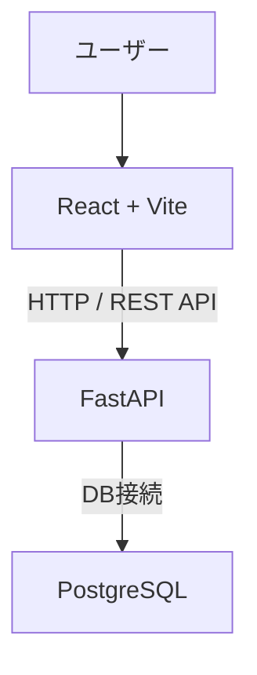

# 買い物リスト

## 目的
Webアプリケーションの開発を通じて、フロントエンドからデータベースまでの基本的な仕組みを理解すること
- フロントエンドとバックエンドのデータのやり取り
- Dockerによる開発環境の構築
- Dockerコンテナ間のネットワーク通信

## 主な機能
- 商品一覧の表示
- 商品の登録
- 商品情報の編集
- 商品の削除
- 日付をカレンダーで表示

## 技術スタック
- React
- Vite
- Python
- FastAPI
- PostgreSQL
- Docker
- DockerCompose

## システム構成

## ディレクトリ構成

## 学習内容
- フロントエンドとバックエンド間の連携
- REST APIの設計
- データベース設計とCRUD処理
- Dockerコンテナ間の通信設定
